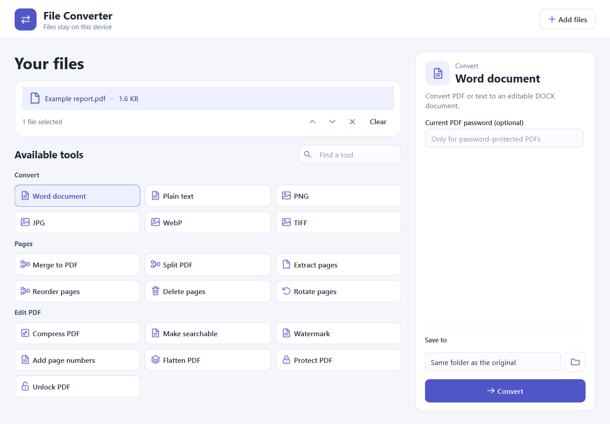

# File Converter

Convert files and edit PDFs from a Windows desktop app or directly from File Explorer. The app runs on your PC and saves a new copy of each output.



## Install on Windows

**Requirements**

- Windows 11 or Windows 10 version 1809 or later on an x64 PC. [Qt for Windows platform support](https://doc.qt.io/qt-6.12/windows.html)
- Standard 64-bit Python 3.13. Choose the Windows installer (64-bit), or run `py install 3.13` if you already use Python Install Manager. [Python downloads for Windows](https://www.python.org/downloads/windows/)
- Internet access during setup to download the Python packages and English OCR data. Conversions run offline afterward.

**Setup**

1. On GitHub, choose **Code → Download ZIP** and extract the ZIP into a folder you can keep, such as `Documents\File Converter`. Git is optional.
2. Double-click **Install File Converter.cmd**. Setup creates a Python environment inside the folder and adds shortcuts for your Windows account. It runs without administrator rights.
3. Open **File Converter** from Start, or double-click **Open File Converter.cmd** in the extracted folder.

The shortcuts point to the extracted folder. If you move it, delete the generated `.venv` folder from the new location and run setup there again.

## Convert a file or edit a PDF

- **From File Explorer** — Right-click a supported file and choose **Convert**. On Windows 11, open **Show more options** first. The app opens with that file and its available tools.
- **From the app** — Drop files onto the window or choose **Add files**. Pick a tool, adjust its settings, and run it. Use **Save to** to choose a destination. Each output goes beside its original by default, with a number added if the name is taken.
- **To merge files** — Add two or more PDFs or images, use the up and down arrows to set their order, and choose **Merge to PDF**. The merged file goes in the first file's folder unless you choose another destination.

| Input | Available conversions and tools |
| --- | --- |
| PDF | Convert to Word (`.docx`), plain text, PNG, JPG, WebP, or TIFF. Merge, split, extract, reorder, delete, rotate, compress, watermark, add page numbers, flatten annotations and form fields, manage passwords, or make scans searchable. |
| Images | Convert among PNG, JPG, WebP, AVIF, TIFF, BMP, GIF, ICO, and HEIC. Resize images or turn them into PDF pages. |
| Office files and CSV | Export to PDF using the corresponding installed Microsoft Office app or LibreOffice. DOCX-to-TXT works directly in File Converter. |
| TXT and Markdown | Save as an editable DOCX or printable PDF. Markdown is treated as plain text. |

PDF-to-Word preserves layout best when the PDF already contains selectable text. Scanned pages use English OCR and export to an editable DOCX with a plain-text layout. For a searchable PDF that keeps the original page appearance, use **Make searchable**.

## Update or remove

- **Update** by extracting the latest source over the existing app folder, or running `git pull` in a Git checkout. Run the installer again to refresh dependencies and shortcuts.
- **Remove** the Start shortcut and Explorer menu by running the command below from the app folder in PowerShell. Move any files you saved inside the app folder before deleting it.

```powershell
powershell -NoProfile -ExecutionPolicy Bypass -File .\Remove-Explorer-Integration.ps1
```

## Troubleshooting

| Issue | What to check |
| --- | --- |
| Setup can't find Python | Run `py -3.13 --version` in a new terminal. Install the 64-bit Python 3.13 runtime and rerun setup if the command fails. |
| Convert is missing | On Windows 11, check **Show more options**. The menu appears when you right-click a single supported file. If the folder moved, rerun setup in its new location. |
| Office-to-PDF export is unavailable | Install the Microsoft Office app for that file type or LibreOffice. |
| English OCR data is missing | Rerun the installer with internet access. |

## Develop locally

Install Git for Windows if you want to clone the repository and track your changes. [Git for Windows](https://gitforwindows.org/)

```powershell
git clone https://github.com/LakiCodes/file-converter.git
cd file-converter
powershell -NoProfile -ExecutionPolicy Bypass -File .\Install.ps1 -SkipWindowsIntegration
.\.venv\Scripts\python.exe .\launch.pyw
```

The tool catalog is in `converter/catalog.py`, conversion logic in `converter/engine.py`, and the desktop interface in `converter/app.py`. Windows integration is registered by `converter/setup_windows.py`. Run `Install.ps1` without `-SkipWindowsIntegration` when working on Explorer or Start menu behavior.

## Third-party components

PDF processing uses PyMuPDF and PDF-to-Word conversion uses pdf2docx. OCR uses the Tesseract English language data downloaded at setup. [PyMuPDF licensing](https://pymupdf.readthedocs.io/en/latest/about.html#license-and-copyright) · [Tesseract data and license](tessdata/LICENSE)
